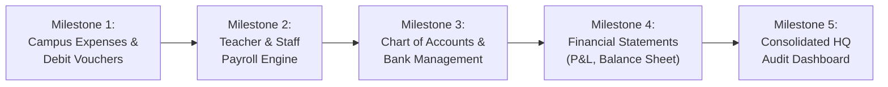

# 🏛️ Institutional Financial ERP & Campus Accounting Architecture
## Project Master Plan & One-to-One Implementation Roadmap

---

## ১. ভূমিকা ও লক্ষ্য (Vision & Objectives)

একটি শিক্ষাপ্রতিষ্ঠান (স্কুল/কলেজ/মাদ্রাসা)-এর প্রশাসনিক ও ব্যবসায়িক স্বচ্ছতা নিশ্চিত করার প্রধান স্তম্ভ হলো তার **সম্পূর্ণ হিসাব-নিকাশের অটোমেশন**। 

আমাদের সফটওয়্যারের বর্তমান ভার্সনে শিক্ষার্থীদের ফি নির্ধারণ, ইনভয়েসিং, কালেকশন কাউন্টার এবং দৈনিক ক্যাশিয়ার শিফট ক্লোজিং অত্যন্ত সফলভাবে কার্যকর রয়েছে। 

এই মাস্টার প্ল্যানের উদ্দেশ্য হলো সফটওয়্যারটিকে কেবল একটি ফি কালেকশন সফটওয়্যার থেকে উন্নীত করে একটি **পূর্ণাঙ্গ প্রাতিষ্ঠানিক ফিন্যান্সিয়াল ইআরপি (Complete Institutional Financial Accounting & ERP)**-এ রূপান্তরিত করা—যাতে একটি ক্যাম্পাসের আয়, ব্যয়, পে-রোল, ব্যাংক হিসাব এবং বার্ষিক সিএ অডিট রিপোর্ট ১টি প্ল্যাটফর্ম থেকেই নিখুঁতভাবে পরিচালিত হতে পারে।

---

## ২. সফটওয়্যারের মান আন্তর্জাতিক মানের (Top-Notch Enterprise Quality) করার মানদণ্ড

যেকোনো ফিন্যান্সিয়াল সফটওয়্যারের গ্রহণযোগ্যতা নির্ভর করে তার হিসাবের নির্ভুলতা, অডিট ট্রেইল এবং সিকিউরিটির ওপর। আমরা নিচের ৬টি স্তম্ভ কঠোরভাবে নিশ্চিত করব:

1. **দ্বৈত দাখিলা ও ব্যালেন্স নিশ্চায়ন (Double-Entry Bookkeeping Integrity):**
   - কোনো হিসাব বাতাসে হারিয়ে যাবে না। প্রতিটি আয়ের বিপরীতে ক্যাশ/ব্যাংক ডেবিট এবং ফি রেভিনিউ ক্রেডিট হবে।
   - প্রতিটি খরচের বিপরীতে এক্সপেন্স হেড ডেবিট এবং ক্যাশ/ব্যাংক ক্রেডিট হবে।
   - সম্পদ = দায় + মূলধন (Assets = Liabilities + Equity) সর্বদা শূন্য-পার্থক্য (Zero Imbalance) বজায় রাখবে।

2. **ক্যাম্পাসভিত্তিক ডাটা নিরাপত্তা ও বিচ্ছিন্নতা (Strict Campus Isolation):**
   - প্রতিটি ফিন্যান্সিয়াল ভাউচার, ট্রানজেকশন এবং ব্যাংক অ্যাকাউন্ট `CampusId` দ্বারা সুরক্ষিত থাকবে।
   - ধানমন্ডি ক্যাম্পাসের অ্যাকাউন্ট্যান্ট কখনই উত্তরা বা মিরপুর ক্যাম্পাসের ব্যাংক ব্যালেন্স বা খরচের বিল দেখতে পারবেন না।
   - তবে সুপারঅ্যাডমিন/ট্রাস্টি বোর্ড এক ক্লিকেই প্রতিটি ক্যাম্পাসের তুলনামূলক লাভ-ক্ষতি এবং সমন্বিত (Consolidated) ব্যালেন্স শীট দেখতে পাবেন।

3. **ভাউচার অনুমোদন ওয়ার্কফ্লো (Multi-Level Approval Workflow):**
   - অ্যাকাউন্ট্যান্ট খরচের ভাউচার তৈরি (Draft) করবেন -> প্রিন্সিপাল বা অর্থ কমিটির সভাপতি অনুমোদন (Approve) করবেন -> এরপর ক্যাশিয়ার বা ব্যাংক থেকে টাকা ডিসবার্স (Disburse) হবে।
   - অননুমোদিত কোনো ভাউচার দিয়ে প্রাতিষ্ঠানিক ফান্ড থেকে টাকা বের হওয়া অসম্ভব।

4. **ডিজিটাল ক্যাশমেমো ও বিল প্রমাণ সংযুক্তি (Digital Proof Attachment):**
   - প্রতিটি খরচের সাথে দোকান বা সরবরাহকারীর আসল ক্যাশমেমোর ছবি/পিডিএফ আপলোড করার ব্যবস্থা থাকবে।
   - প্রতিটি ভাউচারে প্রাতিষ্ঠানিক লেটারহেড এবং তিনটি অফিশিয়াল স্বাক্ষর থাকবে: `Prepared By`, `Verified By`, `Approved By`।

5. **উপস্থিতির সাথে বেতনের স্বয়ংক্রিয় লিংক (Real-Time Payroll Integration):**
   - শিক্ষকদের মাসিক অনুপস্থিতি বা অবৈতনিক ছুটি (Leave Without Pay) ম্যানুয়ালি হিসাব করার প্রয়োজন নেই; সফটওয়্যারের বায়োমেট্রিক/ডেইলি অ্যাটেনডেন্স সিস্টেম থেকে স্বয়ংক্রিয়ভাবে হিসাব হয়ে পে-স্লিপ তৈরি হবে।

6. **জিরো মক ডাটা ও ১০০% লাইভ ডাটাবেজ (Zero Mock Data):**
   - পুরো হিসাব-নিকাশ লাইভ PostgreSQL ডাটাবেজে স্টোর হবে এবং কোনো ফেক/হার্ডকোডেড ডাটা ব্যবহার করা হবে না।

---

## ৩. ধাপভিত্তিক ওয়ান-টু-ওয়ান কাজের পরিকল্পনা (One-to-One Execution Roadmap)

---

### 📌 মাইলস্টোন ১: ক্যাম্পাস ব্যয় ও ডেবিট ভাউচার ব্যবস্থাপনা (Campus Expense & Voucher System)
> **লক্ষ্য:** ক্যাম্পাসের বাড়িভাড়া, বিদ্যুৎ, গ্যাস, ইন্টারনেট বিল, পরীক্ষার প্রশ্ন প্রিন্টিং, বিজ্ঞানাগার, স্টেশনারি ও সাংস্কৃতিক অনুষ্ঠানের খরচের নিখুঁত ভাউচার তৈরি ও প্রিন্ট।

#### ১.১ ডাটাবেজ মডেল (Backend Domain):
- `ExpenseCategory`: খরচের প্রধান খাতসমূহ (Utilities, Building Rent, Exam Printing, Stationery, Lab Equipment, Maintenance, Advertising, Cultural Events)।
- `ExpenseVoucher`:
  - `Id`, `CampusId`, `VoucherNo` (অটো জেনারেটেড: `EXP-2026-0001`)
  - `ExpenseDate`, `ExpenseCategoryId`, `Amount`
  - `PaymentMethod`: `Cash` | `Bank Cheque` | `bKash`
  - `PaidTo`: বিক্রেতা বা সরবরাহকারীর নাম
  - `AttachmentUrl`: রসিদ বা বিলের স্ক্যান কপি
  - `Status`: `Draft` | `Pending_Approval` | `Approved` | `Paid` | `Rejected`
  - `CreatedBy`, `ApprovedBy`, `ApprovalDate`, `Notes`
- `ExpenseVoucherItem`: একটি ভাউচারের অধীনে একাধিক খুচরা আইটেম (যেমন: মার্কার ১০টি, খাতা ৫ রিম, ডাস্টার ৪টি)।

#### ১.২ ব্যাকএন্ড অ্যাপ্লিকেশন সার্ভিস ও কন্ট্রোলার:
- `IExpenseService.cs` এবং `ExpenseService.cs`
- `ExpensesController.cs`:
  - `GET /api/v1/finance/expenses`: ফিল্টার বাই ডেট রেঞ্জ, ক্যাটাগরি, স্ট্যাটাস।
  - `POST /api/v1/finance/expenses`: নতুন ভাউচার ড্রাফট এন্ট্রি।
  - `POST /api/v1/finance/expenses/{id}/approve`: প্রিন্সিপাল বা অথরিটির অনুমোদন।
  - `POST /api/v1/finance/expenses/{id}/upload-receipt`: বিলের ছবি আপলোড।
  - `GET /api/v1/finance/expenses/summary`: চলতি মাসের মোট খরচ বনাম আগের মাস।

#### ১.৩ ফ্রন্টএন্ড UI কম্পোনেন্ট:
- রুট: `/app/finance/expenses` (`expense-management.component.ts`)
- খরচের সামারি কার্ড: Today's Expense, This Month Total, Pending Approvals, Utility Bills।
- ভাউচার ফিল্টার বার: তারিখ ভিত্তিক ফিল্টারিং, ক্যাটাগরি ড্রপডাউন, স্ট্যাটাস পিলস।
- **New Debit Voucher Modal:**
  - ভেন্ডরের নাম, পেমেন্ট চ্যানেল, ক্যাটাগরি সিলেক্টর, একাধিক আইটেমের ডায়নামিক রো।
  - বিল ভাউচারের ছবি ড্র্যাগ অ্যান্ড ড্রপ ফাইল আপলোডার।
- **প্রিন্টেবল অফিশিয়াল ডেবিট ভাউচার (Official Debit Voucher Printout):**
  - এ-ফোর পোট্রেট পেপারে প্রাতিষ্ঠানিক সিল ও লেটারহেড।
  - প্রস্তুতকারী, হিসাবরক্ষক ও প্রিন্সিপালের ৩টি সিগনেচার বক্স।

---

### 📌 মাইলস্টোন ২: শিক্ষক ও কর্মকর্তা-কর্মচারীদের পে-রোল ও বেতন-ভাতা (Staff Payroll System)
> **লক্ষ্য:** প্রতি মাসের শেষে ১ ক্লিকে সমস্ত শিক্ষক ও কর্মচারীদের বেতন শিট প্রস্তুত, ছুটির কর্তন সমন্বয় এবং ব্যক্তিগত পে-স্লিপ প্রিন্ট।

#### ২.১ ডাটাবেজ মডেল (Backend Domain):
- `SalaryStructure`:
  - `EmployeeId`, `BasicPay`, `HouseRent`, `MedicalAllowance`, `Conveyance`, `SpecialAllowance`
- `EmployeePayroll`:
  - `Id`, `CampusId`, `SalaryMonthYear` (`November 2026`)
  - `EmployeeId`, `GrossSalary`, `LeaveDeduction`, `ProvidentFundDeduction`, `AdvanceDeduction`, `NetPayable`
  - `PaymentStatus`: `Generated` | `Approved` | `Disbursed`
  - `DisbursementDate`, `PaymentMethod` (Bank Transfer / Cash / bKash)

#### ২.২ অটোমেশন লজিক:
- শিক্ষকের দৈনিক হার = $\text{Basic} / 30$
- চলতি মাসে কতদিন অবৈতনিক ছুটি ছিল তা সরাসরি `AttendanceRecord` ও `TeacherLeaveApplication` থেকে কাউন্ট হয়ে অটোমেটিক `LeaveDeduction` ক্যালকুলেট হবে।

#### ২.৩ ফ্রন্টএন্ড UI কম্পোনেন্ট:
- রুট: `/app/finance/payroll` (`payroll-management.component.ts`)
- **Generate Monthly Payroll Action:** মাস নির্বাচন করে ক্লিক করলেই ক্যাম্পাসের সকল শিক্ষক-কর্মচারীর স্যালারি শিট তৈরি।
- **Official Pay Slip Modal:** শিক্ষকভিত্তিক সম্পূর্ণ পে-স্লিপ প্রিন্ট ভিউ।
- **Bank Advisory Export:** সোনালী/ডাচ্-বাংলা ব্যাংকে প্রেরণের জন্য অ্যাকাউন্ট নাম্বারসহ ফরম্যাটেড এক্সেল/পিডিএফ শিট।

---

### 📌 মাইলস্টোন ৩: হিসাব তালিকা ও ব্যাংক-ক্যাশ সমন্বয় (Chart of Accounts & Treasury)
> **লক্ষ্য:** স্কুলের একাধিক ব্যাংক অ্যাকাউন্ট, কাউন্টার ক্যাশ ও মোবাইল ওয়ালেট (bKash/Nagad)-এর দৈনিক হিসাব সমন্বয়।

#### ৩.১ ডাটাবেজ মডেল:
- `ChartOfAccount`:
  - `1000 Assets` (1010 Counter Cash, 1020 DBBL Account, 1030 Sonali Bank, 1040 bKash Merchant)
  - `2000 Liabilities` (2010 Advance Fees, 2020 Teacher PF Payable, 2030 Vendor Payable)
  - `3000 Equity` (3010 General Reserve Fund, 3020 Trustee Contribution)
  - `4000 Revenue` (4010 Monthly Tuition, 4020 Admission Fee, 4030 Exam Fee, 4040 Bus Fee)
  - `5000 Expenses` (5010 Teacher Salaries, 5020 Electricity, 5030 Rent, 5040 Exam Printing)
- `BankTransaction`:
  - কাউন্টার থেকে ক্যাশ নিয়ে ব্যাংকে জমা দেওয়ার এন্ট্রি (`Cash-to-Bank Deposit`).
  - চেকের স্ট্যাটাস ট্র্যাকিং (`Pending Clearing`, `Cleared`, `Bounced`).

#### ৩.২ ফ্রন্টএন্ড UI কম্পোনেন্ট:
- রুট: `/app/finance/banking` (`banking-treasury.component.ts`)
- লাইভ ব্যালেন্স ট্র্যাকার: ক্যাশে কত টাকা আছে, কোন ব্যাংকে কত ব্যালেন্স, বিকাশ মার্চেন্টে কত আছে।
- কাউন্টার ক্যাশ সরাসরি ব্যাংকে ডিপোজিট ট্র্যাকিং উইন্ডো।

---

### 📌 মাইলস্টোন ৪: অডিট-গ্রেড আর্থিক বিবরণী (Audit-Grade Financial Statements)
> **লক্ষ্য:** পরিচালনা পর্ষদ, অডিটর বা শিক্ষা বোর্ডের চাহিদামতো তাৎক্ষণিক আয়-ব্যয় বিবরণী, উদ্বৃত্তপত্র এবং রেওয়ামিল তৈরি।

#### ৪.১ প্রধান চারটি আর্থিক রিপোর্ট:
1. **আয়-ব্যয় বিবরণী (Income & Expenditure Statement / P&L):**
   $$\text{Net Operating Surplus} = \text{Total Student Revenue} - (\text{Campus Expenses} + \text{Staff Salaries})$$
   - গ্রাফিক্যাল ট্রেন্ড: মাসভিত্তিক আয়ের তুলনায় ব্যয়ের গতিধারা।
2. **আর্থিক অবস্থার বিবরণী (Balance Sheet / Statement of Financial Position):**
   - বর্তমান সম্পদ (ক্যাশ, ব্যাংক ব্যালেন্স, শিক্ষার্থীদের কাছে মোট বকেয়া পাওনা)।
   - চলতি দায় (বকেয়া বিল, স্টাফ প্রভিডেন্ট ফান্ড)।
   - সংরক্ষিত তহবিল (Net Institutional Reserves)।
3. **রেওয়ামিল (Trial Balance):**
   - সমস্ত অ্যাকাউন্ট হেডের ডেবিট ও ক্রেডিট এন্ট্রি ব্যালেন্সের নিখুঁত যাচাই।
4. **বাজেট বনাম প্রকৃত ব্যয়ের বিশ্লেষণ (Budget vs Actual Variance Report):**
   - প্রতিটি খাতে কত টাকা বাজেট বরাদ্দ ছিল এবং কত খরচ হয়েছে।

#### ৪.২ ফ্রন্টএন্ড UI:
- `/app/reports/financial`: প্রফেশনাল প্রিন্ট ও এক্সেল এক্সপোর্ট বোতাম সহকারে ট্যাব ভিত্তিক অডিট ইন্টারফেস।

---

### 📌 মাইলস্টোন ৫: মাল্টি-ক্যাম্পাস হেডকোয়ার্টার কনসোলিডেশন (HQ Multi-Campus Analytics)
> **লক্ষ্য:** ট্রাস্টি বোর্ড বা চেয়ারম্যানের জন্য সমস্ত ব্রাঞ্চের সামগ্রিক আর্থিক পারফরম্যান্স এক নজরে দেখা।

- **ক্যাম্পাস ফিল্টার ও তুলনা:** ধানমন্ডি বনাম মিরপুর বনাম উত্তরা ব্রাঞ্চের রাজস্ব ও ব্যয়ের তুলনা।
- **ইন্টার-ক্যাম্পাস ফান্ড ট্রান্সফার:** এক ক্যাম্পাস থেকে অন্য ক্যাম্পাসে ঋণ বা জরুরি ফান্ড ট্রান্সফার সমন্বয়।

---

## ৪. বাস্তবায়নের কর্মপরিকল্পনা ও টেকনিক্যাল স্ট্যান্ডার্ড

| ধাপ | মডিউল | মূল ফাইলসমূহ | ডেলিভারেবলস |
| :--- | :--- | :--- | :--- |
| **Phase 1** | **Campus Expense & Voucher** | `backend/src/.../Finance/Expense*.cs` `Fontend/src/.../finance/expense-management.component.ts` | • খরচের এন্ট্রি ও অনুমোদন • বিল ছবি আপলোড • ৩-স্বাক্ষর সম্বলিত অফিশিয়াল ভাউচার প্রিন্ট |
| **Phase 2** | **Teacher & Staff Payroll** | `backend/src/.../Employee/Payroll*.cs` `Fontend/src/.../finance/payroll-management.component.ts` | • ১-ক্লিকে মাসিক স্যালারি শিট • ছুটির ভিত্তিতে বেতন কর্তন • শিক্ষকের পে-স্লিপ প্রিন্ট |
| **Phase 3** | **Chart of Accounts & Banking** | `backend/src/.../Finance/Banking*.cs` `Fontend/src/.../finance/banking-treasury.component.ts` | • হিসাব তালিকা (COA) • ক্যাশ থেকে ব্যাংকে জমা ট্র্যাকিং • ক্যাশ ভল্ট রিকনসিলিয়েশন |
| **Phase 4** | **Audit Statements (P&L, Balance Sheet)** | `backend/src/.../Finance/FinancialReport*.cs` `Fontend/src/.../reports/reports.component.ts` | • অডিট-রেডি আয়-ব্যয় বিবরণী • ব্যালেন্স শিট ও ট্রায়াল ব্যালেন্স • এক্সেল ও পিডিএফ এক্সপোর্ট |

---

## ৫. উপসংহার
এই কাঠামো বাস্তবায়িত হলে সফটওয়্যারটির গ্রহণযোগ্যতা এবং বাণিজ্যিক মান সাধারণ স্কুল ম্যানেজমেন্ট সফটওয়্যার থেকে সরাসরি **Enterprise Grade Education ERP** স্তরে উন্নীত হবে। যেকোনো বড় শিক্ষা প্রতিষ্ঠান সম্পূর্ণ নির্ভুলভাবে তাদের শতভাগ আর্থিক কার্যক্রম এই সফটওয়্যারে পরিচালনা করতে সক্ষম হবে।
